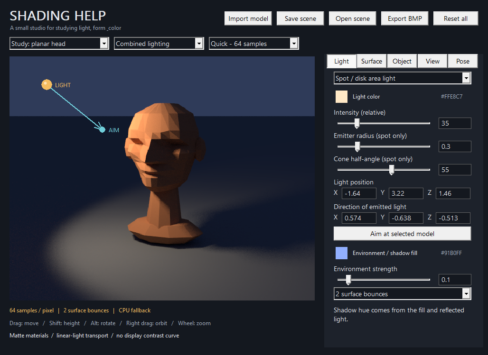

# Shading Help

A free, native Windows light-and-form study app for drawing. C++17, Win32, no browser or webview, no account, no internet connection, no external runtime. The renderer uses your GPU through Direct3D 11, with a CPU fallback when compatible hardware is unavailable.



This test-machine screenshot shows CPU fallback because the runner has no hardware GPU. Compatible Windows PCs use the GPU automatically; the View tab shows the active device.

## Get the Windows application

Download the **ShadingHelp-Windows-x64** artifact from a successful [Windows build](https://github.com/Basti-Wood/Shading-help/actions/workflows/windows.yml), extract it, and run `ShadingHelp.exe`. GitHub may require sign-in to download build artifacts. The executable is unsigned and does not need installation.

**[Windows builds and downloads](https://github.com/Basti-Wood/Shading-help/actions/workflows/windows.yml)**

**[Download the verified GPU + model-import build](https://github.com/Basti-Wood/Shading-help/actions/runs/43207292274/artifacts/13940370423)** — [successful checks](https://github.com/Basti-Wood/Shading-help/actions/runs/43207292274) for source commit `545ac7a`: 50 core/import checks, GPU shader comparisons against the CPU reference, Windows UI smoke tests, and Linux address/undefined-behavior sanitizers. GPU shader correctness was checked with Direct3D WARP; no physical GPU performance benchmark was available.

The build runs numerical, renderer and model-import tests, and compares the GPU shaders with the CPU reference. The Windows workflow also exercises model/light/direction dragging, numeric input, file-drop import, renderer selection and settings-page layout. Build artifacts have a retention period; use the latest successful build or compile from source if an older download expires.

Or compile it yourself:

1. Install the free [Microsoft C++ Build Tools](https://visualstudio.microsoft.com/downloads/), with **Desktop development with C++**, the MSVC x64/x86 tools, and a Windows 10/11 SDK. The Visual Studio IDE is not required.
2. Download this repository using **Code → Download ZIP**, then extract it.
3. Double-click **`build.bat`**. It finds Visual Studio / Build Tools automatically, compiles the application, and runs the numerical tests. A failed test makes the build fail.
4. Run **`dist\ShadingHelp.exe`**. The `dist` folder is portable. The MSVC runtime is linked statically; it does not need .NET, Python, a game engine, or additional DLLs.

Windows 10 version 1703 or newer / Windows 11 is required for the UI's DPI support. A 64-bit build is produced when the batch script discovers the compiler. If invoking it from a developer command prompt, choose an **x64 Native Tools** prompt. Once the compiler is installed, compilation and use work offline. `build.bat --ci` skips the final pause.

## Included

| Feature | Implementation |
|---|---|
| Sphere | Exact ray–sphere intersections; a genuinely curved surface |
| Planar head | Original built-in faceted bust, with geometric brow, eye sockets, nose, lips, cheeks and jaw; flat normals |
| Head + sphere | Both in one scene, with independent materials and transforms |
| Mannequin | Block figure with eight poseable joints; hierarchical limb rotations |
| Your own models | Drag in OBJ, STL or PLY, or use Import model / Ctrl+O; imported faces are flat shaded |
| GPU rendering | Direct3D 11 compute shaders perform ray intersections, shadows, diffuse bounces, accumulation and display conversion |
| Move the light | Drag the gold light ball or enter its XYZ position |
| Aim the light | Drag the cyan arrow tip or enter a direction vector; one-click aim at model |
| Light types | Point, spotlight / disk emitter, and directional |
| Color pickers | Object / skin tone, light, environment / shadow fill, floor |
| Bounce light | Sampled diffuse light paths, with 0–8 surface bounces |
| Shadows | Ray-tested self-shadows and cast shadows; sampled area-light penumbras |
| Camera | Orbit, pan, zoom, field of view and roll |
| Study views | Combined, direct + environment, bounce only, albedo, normals, grayscale |
| Saving | Scene files, clean BMP image export, pixel value inspection |

Everything above is free under the repository's Apache-2.0 license. There is no paid tier.

**The bundled head is an original planar study model, not a scan or replica of John Asaro's sculpture.** A specific licensed Asaro model can be imported using the Object tab. No third-party meshes are bundled.

## Controls

| Action | Control |
|---|---|
| Choose a model | Study menu above the viewport |
| Import your own model | Drag one OBJ/STL/PLY file onto the window, use Import model, or Ctrl+O |
| Choose the renderer | View → GPU when available / CPU reference; actual device is shown below |
| Move a model over the floor | Left-drag its visible surface |
| Raise / lower the model | Shift + left-drag the model |
| Rotate a model | Alt + left-drag; or Object tab's pitch, yaw, roll |
| Move the light | Drag the gold ball in the camera-facing plane |
| Raise / lower the light | Shift + drag the gold ball |
| Aim the spotlight / sun | Drag the cyan tip, or edit XYZ in Light tab |
| Aim straight at the model | Light → Aim at selected model |
| Orbit camera | Right-drag, or left-drag empty space |
| Pan camera | Middle-drag |
| Zoom | Mouse wheel over viewport |
| Roll camera | Q / E, or View → Camera roll |
| Frame scene | F, or View → Frame the scene |
| Show / hide light handles | H |
| Change surface color | Surface → Surface / skin tone |
| Set an exact numeric value | Edit the number beside a slider and press Enter |
| Inspect a rendered color | Double-click the viewport; read the footer |
| Pose the mannequin | Select Mannequin, then Pose tab, joint, bend and sideways angle |
| Save / restore | Save scene / Open scene, using `.shade` files |
| Export without UI | Export BMP, using the current render resolution and sample count |

When you drag, the render temporarily reduces its resolution and sample count. Release the mouse to refine it. **Quick / Study / Fine** select 64 / 512 / 2048 samples and maximum image dimensions of 600 / 950 / 1400 pixels, bounded by the viewport size. A few noisy samples are expected while it converges. Fine rendering takes longer, especially with complex meshes or the CPU fallback.

GPU mode requires Direct3D feature level 11_0 (compute shader model 5); an RTX card is not required. The app prefers a compatible hardware adapter with more dedicated video memory. View shows the actual adapter or the CPU fallback reason. Software WARP is used only for shader validation tests and is never presented as hardware acceleration. Scene preparation, mouse picking, file import and the native interface still use the CPU. The expensive per-pixel light transport and display conversion run on the GPU.

The light handle is a UI overlay, not an object that blocks light. If you move it outside the viewport, zoom out or use the numeric position controls. The direction handle uses a virtual sphere around the light. Orbit the camera or enter the vector numerically to reach the far side. A **point light is omnidirectional**, so it has no direction arrow. A **directional light uses direction only**; moving its handle does not change illumination. Emitter radius and cone only apply to the spot light.

## A quick bounce-light study

1. In Surface, click **Try a red-floor bounce study**.
2. Look at the lower part of the ball: reflected light takes on the floor's color.
3. Switch the render menu to **Bounce only** to isolate surface interreflection.
4. Set the bounce count to zero in Light: that contribution disappears.
5. Change the floor to blue or gray and compare. A black floor absorbs light and produces no diffuse bounce.

## What the calculations mean

See [the rendering notes](docs/RENDERING.md) for the equations and limitations.

- All color transport is calculated in **linear RGB**. UI sRGB colors are decoded before lighting, and the final radiance is converted back to sRGB for display.
- Materials are **matte Lambertian reflectors**: `BRDF = albedo / pi`. Skin tone means diffuse surface reflectance; this is not a skin subsurface-scattering simulation.
- Point / spot direct lighting includes the surface cosine, inverse-square distance, and binary geometric visibility. A finite spot emitter samples a disk and includes its emission cosine.
- Diffuse bounces use cosine-weighted Monte Carlo path tracing. The floor and other surfaces actually exchange light according to geometry and material colors.
- The environment is an independently colored, constant-radiance surrounding light, with ray-tested visibility. It provides physical fill in shadows. **A shadow is not an independently colored material.** Changing the fill also affects other exposed surfaces; changing the floor affects reflected light. No arbitrary shadow-color overlay is used.
- The display applies exposure, then the sRGB transfer function, then clipping. There is no hidden filmic curve. Use lower exposure if highlights clip. The inspector shows the current pass's linear luminance before exposure and its final display RGB.

This is a **diffuse study renderer**, not a calibrated spectral measurement or full production renderer. Light intensities use consistent relative units. It does not simulate specular highlights, skin scattering, transparency, or caustics. A finite bounce limit omits longer paths. See the notes for the exact light definitions.

## Importing Blender and other models

In Blender, select your objects and use **File → Export → Wavefront OBJ**, **STL**, or **PLY**. Drop the exported file into Shading Help. `.blend` is a Blender project format and needs that export step first. See [the import guide](docs/IMPORTING.md) for orientation, modifiers, limits and troubleshooting.

OBJ, ASCII/binary STL, and ASCII/little-endian/big-endian PLY are supported. The importer reads mesh geometry and uses flat face normals and the app's surface color. Materials, textures, animation and rigs are not imported. Triangulate concave polygons before export. Point clouds without faces are not supported.

Geometry is centered in X/Z, placed on the ground and scaled so its largest dimension is 2.8. Limits: 64 MB, 300,000 OBJ/PLY vertices, 200,000 resulting triangles. A scene saves the original model's absolute UTF-8 path, not the mesh itself: keep the file, or import it again after moving it. Failed imports leave the current scene intact. Imported models rotate around their own center.

The mannequin has shoulders, elbows, hips and knees. It is not a full anatomy model, has no inverse kinematics or articulated fingers, and does not enforce joint limits or prevent limbs going through the floor.

## Development and testing

No package restore or downloaded dependencies are needed. Windows provides Direct3D 11 and the shader compiler. The application is `src/windows.cpp`; the CPU reference and scene code are `src/core.*`, importers are `src/mesh.cpp`, GPU execution is `src/gpu.cpp` with embedded HLSL in `src/gpu_shader.hpp`, and `src/progressive.*` manages cancellation and accumulation.

On Linux/macOS with a C++17 compiler:

```sh
mkdir -p build
g++ -std=c++17 -O2 -pthread -Wall -Wextra -Wpedantic -Werror src/core.cpp src/mesh.cpp src/gpu.cpp src/progressive.cpp tests/tests.cpp -o build/tests
./build/tests
g++ -std=c++17 -O3 -pthread src/core.cpp src/mesh.cpp src/cli.cpp -o build/shading-render
./build/shading-render build/head.bmp head 128 800 800
```

The optional CMake project builds the same targets and registers tests with CTest, including GPU shader tests on Windows. The interactive UI and GPU backend are Windows-only; the CLI stays a portable CPU reference. CLI arguments are output path, preset **or OBJ/STL/PLY path**, samples, width, height. Presets: `head`, `ball`, `both`, `mannequin`, `bounce`, `direct`, `rim`.

Tests check sRGB transfer, analytic intersections, Lambert's cosine law, distance falloff, shadows, disk-light visibility, environment normalization, red-floor interreflection, BVH correctness, serialization, OBJ/STL/PLY parsing and malformed-file rejection, deterministic rendering, and cancellation of stale jobs. Windows shader tests use WARP to check the real HLSL against CPU radiance and display output, including non-multiple-of-eight image sizes and multiple render modes. They additionally test a physical adapter if the runner has one. WARP success verifies shader correctness, not a physical GPU speed benchmark. GitHub Actions also tests the portable core under address/undefined-behavior sanitizers on Linux.

## Existing applications researched

See [the Windows alternatives comparison](docs/WINDOWS-ALTERNATIVES.md) for download links, screenshots and free/paid limitations. I did not verify an existing free standalone Windows application with this entire combination of a built-in planar head, sphere, draggable light direction and calculated surface-bounce lighting.
